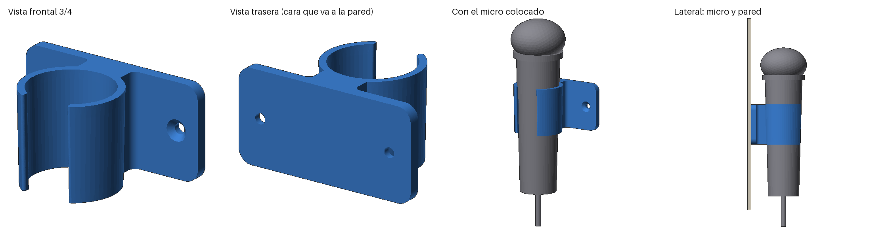

# Soporte de pared para micrófono

Pinza para el micrófono de mano, inspirada en la pinza de Shure, pero con una placa para
**atornillarla a la pared** en lugar de roscarla a un pie de micro.

## Cómo funciona

- La pinza es un aro **cónico** que copia la forma del micro: mide **35,5 mm por dentro
  arriba** y **33,8 mm abajo** (las medidas de 35 y 31 mm más 0,5 mm de holgura, ajustadas
  a la altura de la pinza).
- **Para colocar el micro:** pasa el cable por la ranura de delante y baja el micro desde
  arriba. Se queda encajado por su propio peso, como un vaso en un posavasos.
  **Para sacarlo:** tira hacia arriba.
- La ranura (20 mm) es más estrecha que el micro (31 mm), así que el micro no puede caerse
  hacia delante.
- El centro del micro queda a 32 mm de la pared, para que la cabeza (la parte más ancha)
  no roce con ella.
- Los dos tornillos van a los lados de la pinza, para que llegues con el destornillador.

## Archivos

| Archivo | Para qué sirve |
|---|---|
| `SoporteMicrofonoPared/` | **Script de Fusion 360.** Dibuja el soporte con medidas editables. |
| `soporte_microfono_pared.step` | El mismo soporte ya hecho, por si quieres importarlo sin ejecutar el script (no tiene parámetros). |
| `soporte_microfono_pared.stl` | Listo para imprimir con las medidas por defecto. |

## 1. Ejecutar el script en Fusion 360

1. Descarga la carpeta `SoporteMicrofonoPared` completa (con los dos archivos de dentro).
2. En Fusion 360: **Utilidades → Complementos → Scripts y complementos** (o pulsa `Mayús + S`).
3. Pulsa el botón **+** y elige la carpeta `SoporteMicrofonoPared`.
   En versiones antiguas, es el **+** verde junto a *Mis scripts*. En las nuevas, es
   **+ → Script o complemento desde dispositivo**.
4. Selecciona **SoporteMicrofonoPared** y pulsa **Ejecutar**.

Se abre un diseño nuevo con el soporte. En la línea de tiempo verás cada paso con su nombre:

1. Anillo exterior
2. Placa y cuello
3. Hueco micro
4. Ranura
5. Agujeros
6. Avellanado
7. Esquinas placa
8. Refuerzo cuello
9. Bordes ranura

## 2. Cambiar medidas

**Modificar → Cambiar parámetros**. En *Parámetros de usuario* tienes todas las medidas
con su descripción. Cambia el valor y el modelo se actualiza solo, sin volver a ejecutar
el script.

| Parámetro | Valor | Qué es |
|---|---|---|
| `mic_diam_ancho` | 35 mm | Diámetro del micro en la parte ancha (arriba) |
| `mic_diam_estrecho` | 31 mm | Diámetro del micro en la parte estrecha (abajo) |
| `mic_dist_medidas` | 95 mm | Distancia entre las dos líneas azules de tu foto. **La he estimado a partir de la foto, mídela.** |
| `holgura` | 0,5 mm | Holgura entre el micro y la pinza (en el diámetro) |
| `pinza_alto` | 40 mm | Altura de la pinza (y de la placa) |
| `pinza_grosor` | 3 mm | Grosor de la pared de la pinza |
| `pinza_apertura` | 20 mm | Ancho de la ranura de delante |
| `pinza_redondeo` | 1 mm | Redondeo de los bordes de la ranura |
| `pinza_diam_arriba` | *(fórmula)* | Diámetro interior arriba = `mic_diam_ancho + holgura` |
| `pinza_diam_abajo` | *(fórmula)* | Diámetro interior abajo, calculado con la conicidad del micro |
| `dist_eje_pared` | 32 mm | Distancia de la pared al centro del micro |
| `placa_ancho` | 80 mm | Ancho de la placa |
| `placa_grosor` | 5 mm | Grosor de la placa |
| `placa_radio` | 6 mm | Redondeo de las esquinas de la placa |
| `cuello_ancho` | 20 mm | Ancho del puente entre la placa y la pinza |
| `cuello_radio` | 3 mm | Redondeo de refuerzo entre el puente y la placa |
| `tornillo_diam` | 4,5 mm | Agujero para tornillo de 4 mm |
| `tornillo_cabeza_diam` | 9 mm | Diámetro del avellanado (cabeza del tornillo) |
| `tornillo_sep` | 60 mm | Distancia entre los dos agujeros |

### Cambios típicos

- **El micro baja demasiado o queda flojo** → baja `holgura` (por ejemplo, a 0,2 mm).
  **No entra o queda muy alto** → súbela.
- **La cabeza del micro roza la pared** → sube `dist_eje_pared`.
- **Quieres meter el micro a presión por delante**, como en la pinza Shure → sube
  `pinza_apertura` a unos 28–29 mm. En ese caso imprime en PETG, porque el PLA puede
  partirse al abrirse la pinza.
- **Tornillos de otra medida** → cambia `tornillo_diam` y `tornillo_cabeza_diam`.
- `tornillo_sep` tiene que ser bastante mayor que la pinza (unos 42 mm de ancho por
  fuera). Si no, el agujero cae detrás de la pinza y no llegas con el destornillador.
  Si lo subes, sube también `placa_ancho`.

## 3. Imprimir

- **Exportar:** clic derecho en el cuerpo *Soporte micro* → **Guardar como malla** (STL o 3MF).
- **Orientación:** **de pie**, tal como sale en Fusion: la base plana en la cama y la
  pinza vertical. Así se imprime **sin soportes** y las capas quedan en la dirección
  más resistente.
- **Material:** PLA o PETG.
- **Ajustes:** 3–4 perímetros y 20–30 % de relleno.
